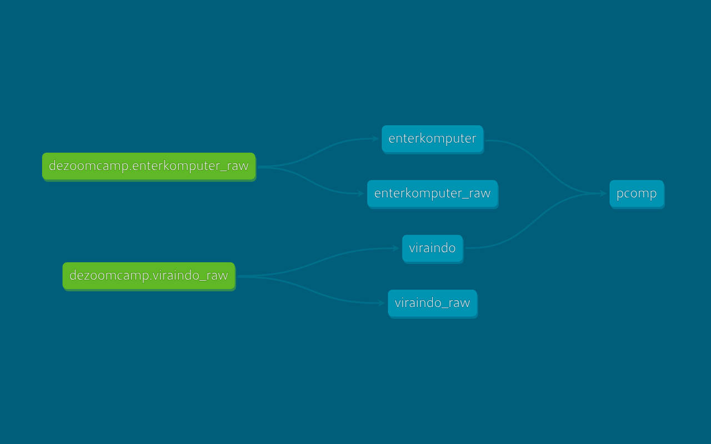
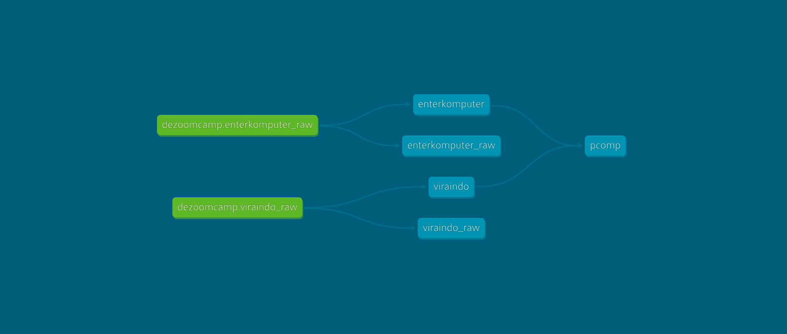
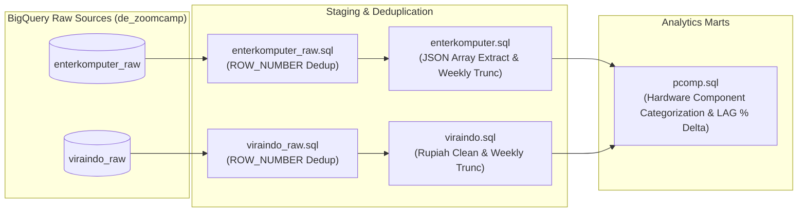
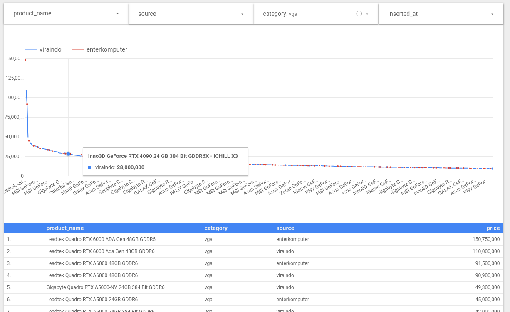

# 🖥️ pcomp_dw: Indonesian PC Hardware Price Intelligence Data Warehouse

A production-grade BigQuery dbt analytics warehouse modeling historical PC hardware pricing from top Indonesian computer retailers (**EnterKomputer** and **Viraindo**).

Inspired by [PCPartPicker](https://pcpartpicker.com/), `pcomp_dw` transforms raw catalog extracts into standardized hardware components, normalizes GPU/CPU/RAM specifications, and calculates week-over-week price deltas for consumer price intelligence.

---

## 📊 Analytics Dashboard & Lineage

### 1. Interactive Analytics Dashboard (Looker Studio)


*The Looker Studio dashboard visualizes hardware component distributions, retailer price comparisons (EnterKomputer vs Viraindo), and price fluctuation trends across GPU, CPU, Memory, and Storage categories.*

### 2. dbt Data Lineage DAG




### 3. BigQuery Storage & Partition Schema


---

## 🏛️ Data Models & Transformation Architecture

| Model | Layer | Materialization | Description |
| :--- | :--- | :--- | :--- |
| `enterkomputer_raw` | Staging | Table | Deduplicates raw API payloads using `ROW_NUMBER() OVER (PARTITION BY pname, kname, pprcz ORDER BY inserted_at)`. |
| `viraindo_raw` | Staging | Table | Deduplicates Viraindo web crawls by `name`, `category`, and `price`. |
| `enterkomputer` | Intermediate | View | Extracts first integer price from JSON array `pprcz`, normalizes category slugs (`Processor` -> `proc`, `SSD`/`Hard Drive` -> `storage`, etc.), and truncates `inserted_at` to weekly date. |
| `viraindo` | Intermediate | View | Cleans currency punctuation (`replace(price, '.', '')`), casts to integer, and aligns weekly insertion timestamps. |
| `pcomp` | Mart | Table / View | Unions both retailer datasets, standardizes general hardware naming (e.g. `Intel Core i5 Series`, `NVIDIA GeForce RTX 4070 SUPER`, `DDR5 32GB`, `SSD M.2 NVMe 1 TB`), and calculates percentage price shifts: `((price - lag(price)) / lag(price)) * 100`. |

---

## ⚡ Execution & Quickstart

### 1. Local-First DuckDB Dashboard (Zero Cloud / No BigQuery Required)
Generate and view an interactive, self-contained HTML price intelligence report with Chart.js:

```bash
# From workspace root: generate local report with dynamic grammar
uv run analysis/dbt-bq/pcomp_dw/scripts/generate_report.py

# Auto-launch directly in browser:
uv run analysis/dbt-bq/pcomp_dw/scripts/generate_report.py --open

# Export directly to public static site (nichsedge.me/pcomp):
uv run analysis/dbt-bq/pcomp_dw/scripts/generate_report.py --export-public

# Enable AI agent fallback (agy/pi) for unclassified silicon edge cases:
uv run analysis/dbt-bq/pcomp_dw/scripts/generate_report.py --ai-fallback
uv run analysis/dbt-bq/pcomp_dw/scripts/generate_report.py --ai-fallback --agent pi
```
- **Report path**: `analysis/dbt-bq/pcomp_dw/reports/pcomp_dashboard.html`
- **Public URL**: `https://nichsedge.me/pcomp/` (via `nichsedge.github.io/public/pcomp/index.html`)
- **💎 Price-to-Performance Value Intelligence**: Joins live online PassMark benchmarks (G3D Mark for GPUs & CPU Mark for processors) scraped from `videocardbenchmark.net` and `cpubenchmark.net`. Zero hardcoded numbers—calculates true Bang-for-Buck value scores (`PassMark Score / (Price / IDR 1,000,000)`).
- **📈 Efficiency Frontier Scatter Plot**: Visualizes the price-to-performance curve, identifying sweet-spot GPUs delivering maximum graphics capability per Rupiah.
- **Dynamic Grammar**: Automatically recognizes next-gen hardware architectures (`RTX 5090`, `RTX 5080`, `RTX 5070`, `RX 9070 XT`, `Intel Arc B580`, `Ryzen 7 9800X3D`, `Core Ultra 9/7/5`, `Z890`, `X870E`, `DDR5 128GB/48GB`, `NVMe 4TB`, etc.) without hardcoding.
- **AI Agent Fallback**: Leverages local terminal agents (`agy --dangerously-skip-permissions` or `pi`) to classify rare workstation or legacy chips and caches results to `data/ai_classified_hardware.json`.
- **Zero Cloud**: Uses embedded in-memory DuckDB to directly query `~/Projects/indoscraping/data/hardware/*/*.json`.
- **Interactive UI**: Multi-tab layout (Value Intelligence, Overview & Silicon, Components & RAM/Storage, Raw Explorer), clickable multi-column sorting (Product Name, Category, Tier, Brand, Retailer, Price, Value Score), quick price bracket filters (`< Rp 3M`, `Rp 3M-10M`, etc.), and `💎 Top Value Only` filter.

---

### 2. Cloud BigQuery dbt Pipeline (Optional / Production)
For warehouse modeling in Google BigQuery:

```bash
# 1. Navigate to pcomp_dw directory
cd analysis/dbt-bq/pcomp_dw

# 2. Compile and run dbt models
uv run dbt run --profiles-dir .

# 3. Test data models
uv run dbt test --profiles-dir .

# 4. Generate & view dbt documentation
uv run dbt docs generate --profiles-dir .
uv run dbt docs serve --profiles-dir .
```
- Requires `GCP_CREDENTIALS_FILE` pointing to a service account with BigQuery Data Editor permissions.

---

## 🔄 Upstream Data Extraction

Scraping crawlers for EnterKomputer, Viraindo, and PassMark Software benchmarks are maintained in the unified [indoscraping](https://github.com/nichsedge/indoscraping) monorepo:
- `indoscraping run enterkomputer`
- `indoscraping run viraindo`
- `indoscraping run passmark` (live online G3D & CPU Mark scraper)
